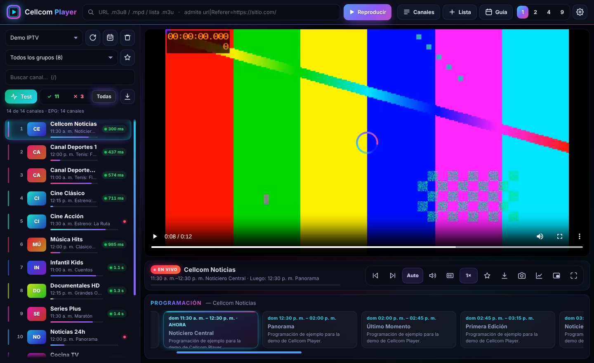
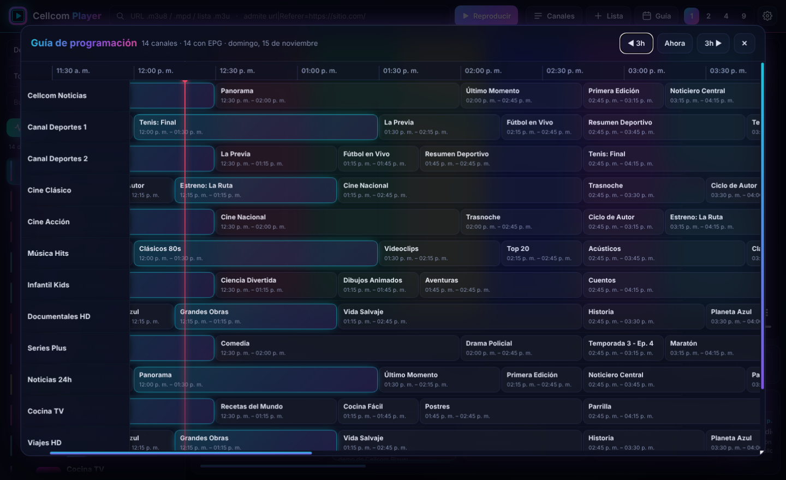
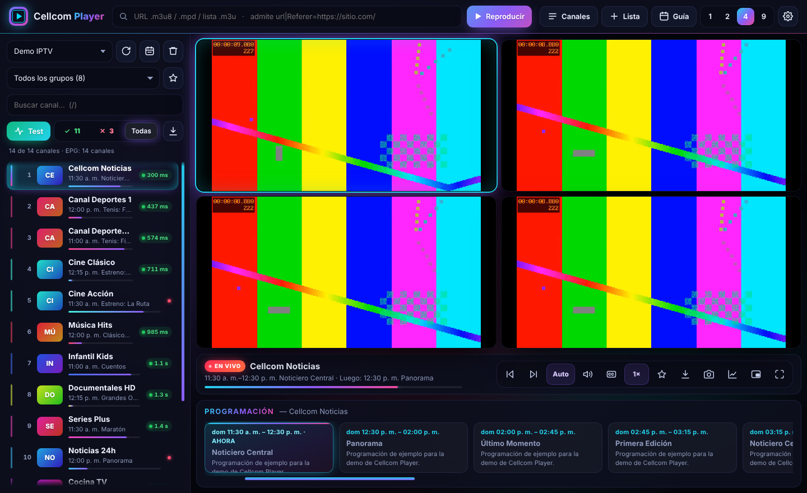

# Cellcom Player

**Reproductor IPTV, HLS (M3U8), DASH (MPD) y MPEG-TS con guía EPG, multivista e imagen en imagen, directo en Chrome, Brave, Edge y Firefox.**

Extensión de navegador (Manifest V3) desarrollada por [Cellcom Technology](https://www.cellcomweb.com.ar). Abre listas M3U y W3U, reproduce los canales sin bloqueos CORS, muestra la programación EPG y permite ver hasta 9 canales a la vez.



---

## Características

### Reproducción
- **HLS / M3U8** con [hls.js](https://github.com/video-dev/hls.js): calidad automática o manual, pistas de audio, subtítulos, AES-128 y modo de baja latencia.
- **DASH / MPD** con [dash.js](https://github.com/Dash-Industry-Forum/dash.js): DRM **ClearKey** (`kid:key`) y **Widevine** (URL de licencia).
- **MPEG-TS continuo y FLV en vivo** con [mpegts.js](https://github.com/xqq/mpegts.js): canales IPTV/Xtream que no entregan m3u8, con reconexión automática.
- **Video directo**: MP4, WebM, MP3, etc.
- **Sin restricciones CORS** y **cabeceras HTTP propias** (Referer, Origin, User-Agent, Cookie), por canal o globales.

### Listas IPTV
- **M3U / M3U8**: `tvg-id`, `tvg-name`, `tvg-logo`, `tvg-chno`, `group-title`, `#EXTGRP`, `#EXTVLCOPT`, `#EXTHTTP`, `#KODIPROP` (ClearKey / Widevine) y cabeceras estilo Kodi (`url|User-Agent=…&Referer=…`).
- **W3U** (listas JSON estilo Wiseplay): grupos anidados, sublistas remotas, `referer`, `userAgent` y `origin`. Tolera comas de más y comentarios.
- **Xtream Codes**: conexión con servidor, usuario y contraseña (arma la lista y la EPG solas).
- Búsqueda, filtro por grupo, favoritos, numeración de canales y lista virtual (miles de canales sin trabarse).
- **Apertura automática**: al visitar un `.m3u8`, `.mpd`, `.m3u`, `.w3u`, un `get.php` de Xtream o una lista cruda (raw de GitHub, pastebin), se abre directamente en el reproductor.

### Guía de programación (EPG)
- XMLTV `.xml` y `.xml.gz`, desde `x-tvg-url` de la lista, Xtream `xmltv.php` o URLs propias (varias a la vez).
- **Modo automático**: elige servidores online de [epgshare01](https://epgshare01.online/epgshare01/) según el país de cada canal (por el sufijo del `tvg-id` o el nombre del grupo). Cada canal busca primero en la EPG de su país.
- Vinculación por `tvg-id` o por nombre normalizado (ignora HD/FHD, tildes y variantes como "Crónica" / "Crónica TV").
- "Ahora / luego" en cada canal, panel de programación y **guía en grilla** de 12 h.



### Herramientas
- **Multivista** de 1, 2, 4 o 9 pantallas.
- **Test de señales**: prueba todos los canales en paralelo (incluye la descarga de un segmento real) y muestra solo los que responden, con su tiempo de respuesta. También permite ver los que fallan y por qué, y exportar un `.m3u` solo con los que funcionan.
- **Exportar M3U del canal actual**, con sus cabeceras, DRM y la EPG vinculada.
- **Detector de streams**: el ícono muestra los `.m3u8`/`.mpd` que carga la página abierta, para reproducirlos con un clic.
- Imagen en imagen, pantalla completa, captura PNG, velocidad y estadísticas con diagnóstico de cortes y cuadros por segundo.
- Interfaz oscura con efectos y luz ambiental, y **modo liviano** para equipos lentos.



---

## Instalación

### Chrome, Brave, Edge u Opera (sin tienda)
1. Descargá este repositorio (**Code → Download ZIP**) y descomprimilo en una carpeta fija.
2. Abrí `chrome://extensions` (Brave: `brave://extensions`, Edge: `edge://extensions`).
3. Activá **Modo de desarrollador**.
4. Tocá **Cargar extensión sin empaquetar** y elegí la carpeta que contiene `manifest.json`.

### Firefox (140 o superior)
- **Para probar**: `about:debugging` → *Este Firefox* → **Cargar complemento temporal** → elegí `manifest.json`. Se borra al cerrar Firefox.
- **Instalación permanente**: Firefox solo instala complementos firmados por Mozilla. Usá la versión publicada en addons.mozilla.org, o firmá el paquete vos mismo como *autodistribución* (ver [BUILD.md](BUILD.md)).

### Paquetes para las tiendas
```bash
node tools/build.mjs
```
Genera en `dist/`:
- `cellcom-player-chrome-X.zip`: para Chrome Web Store, Microsoft Edge Add-ons y Opera Add-ons.
- `cellcom-player-firefox-X.zip`: para addons.mozilla.org.
- `cellcom-player-source-X.zip`: código fuente que pide la revisión de Mozilla.

No necesita instalar nada además de Node.js. Detalles en [BUILD.md](BUILD.md).

## Uso rápido

- **Un stream**: pegá la URL en la barra superior y tocá **Reproducir**. Para cabeceras: `https://servidor/canal.m3u8|Referer=https://sitio.com/`.
- **Una lista**: **＋ Lista** → URL M3U/W3U, archivo local o Xtream Codes.
- **EPG**: botón de calendario en la barra de canales → **Fuentes EPG**.
- **Desde una página web**: reproducí el video en el sitio, tocá el ícono de la extensión y elegí el stream detectado (se abre con el Referer correcto).
- **Menú contextual**: clic derecho en un enlace o video → *Reproducir con Cellcom Player*. Atajo global: `Alt+Shift+P`.

## Atajos de teclado

| Tecla | Acción | Tecla | Acción |
|---|---|---|---|
| Espacio / K | Reproducir / pausa | ↑ ↓ · RePág AvPág | Canal anterior / siguiente |
| F | Pantalla completa | ← → | −10 s / +10 s |
| M | Silencio | + / − | Volumen |
| P | Imagen en imagen | 0-9 | Ir al número de canal |
| S | Captura | G | Guía |
| I | Estadísticas | C | Mostrar / ocultar canales |
| E | Mostrar / ocultar EPG | / | Buscar |
| T | Test de señales | X | Exportar M3U del canal actual |
| F2 | Favorito | | |

## Permisos

| Permiso | Para qué se usa |
|---|---|
| Acceso a todos los sitios | Reproducir sin bloqueos CORS, detectar streams y abrir listas crudas. |
| `declarativeNetRequestWithHostAccess` | Abrir solos los `.m3u8`/`.mpd` y aplicar Referer/Origin/User-Agent solo a los pedidos del reproductor. |
| `webRequest` | Detectar los streams que carga cada pestaña (solo direcciones `.m3u8`/`.mpd`). |
| `activeTab`, `storage`, `contextMenus`, `unlimitedStorage` | Leer la pestaña actual al abrir el ícono, guardar listas/EPG/ajustes y el menú contextual. |

Todo queda guardado en el navegador: la extensión no envía datos a ningún servidor propio.

## Estructura

```
manifest.json      Configuración de la extensión (MV3)
background.js      Service worker: redirecciones, cabeceras, detector, menú contextual
detect.js          Script de contenido: abre listas M3U/W3U mostradas como texto
popup.html / .js   Ventana del ícono
player.html / .css / .js   Reproductor, listas, EPG, test y guía
lib/               hls.js 1.7.0, dash.js 4.7.4, mpegts.js 1.8.2
icons/             Íconos
docs/              Capturas
vendor/mpegts.js/  Código fuente original de mpegts.js (sin modificar)
tools/             build-mpegts.mjs (compila mpegts.js) y build.mjs (arma los paquetes)
```

> **mpegts.js** no tiene una versión compilada lista para usar: `tools/build-mpegts.mjs` la compila desde `vendor/mpegts.js/src` como módulos ES y sin workers (los workers de webpack no funcionan en extensiones MV3). Por el mismo motivo, hls.js corre sin worker.

## Limitaciones

- Los canales MPEG-TS necesitan video H.264/H.265 y audio AAC/MP3/AC-3. El MPEG-2 (señales satelitales viejas) no se puede decodificar en el navegador.
- Widevine depende del módulo de descifrado del navegador. En Brave hay que activarlo en la configuración.
- Las cabeceras se aplican a toda la pestaña del reproductor: en multivista se usan las del último canal cargado.
- La EPG de epgshare01 cubre 2 o 3 días y no incluye todos los canales de cada país.

## Créditos y licencias

El código de Cellcom Player se publica bajo la **licencia MIT** (ver [LICENSE](LICENSE)). Las librerías incluidas mantienen sus propias licencias:

- [hls.js](https://github.com/video-dev/hls.js): Apache License 2.0
- [dash.js](https://github.com/Dash-Industry-Forum/dash.js): BSD 3-Clause
- [mpegts.js](https://github.com/xqq/mpegts.js): Apache License 2.0
- EPG pública: [epgshare01.online](https://epgshare01.online/epgshare01/)

## Aviso legal

Cellcom Player es solo un reproductor: **no incluye ni distribuye canales, listas ni contenido**. Cada usuario es responsable de las listas y fuentes que carga y de tener los derechos para verlas.

---

Hecho en Argentina por **Cellcom Technology** · [www.cellcomweb.com.ar](https://www.cellcomweb.com.ar)
